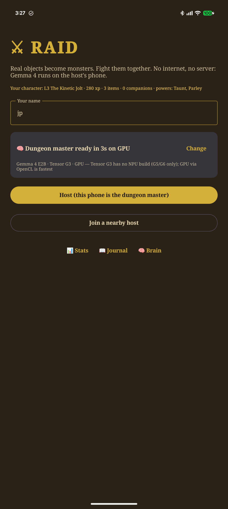

# Raid — a co-op AR RPG where Gemma 4 is the dungeon master

*Built in one day at MLH Hacktoberfest Hack Day (Draper x AMH), 2026-10-16.*

🏆 **Winner — Best Use of Gemma 4 (Google DeepMind)**, one of the two winning projects out of 10 submissions. Gemma 4 E2B runs fully on the phone through LiteRT-LM: vision, audio and function calling, no server. [Official results](https://www.mlh.com/events/hacktoberfest-hack-day-draper-x-amh/submissions).

Point your phone at anything in the room. **Gemma 4 E2B, running entirely on the phone**, turns it into a
monster. Your friends' phones connect to yours over Bluetooth / Wi-Fi Direct — no internet, no server — and
you fight it together: turn to face it, flank it from different sides, shout or type what you do, and Gemma
adjudicates every move through function calls so the game state stays deterministic and synced.

## How it works

| Piece | Tech |
|---|---|
| Brain | Gemma 4 E2B (`litert-community/gemma-4-E2B-it-litert-lm`, Apache 2.0) via [LiteRT-LM](https://github.com/google-ai-edge/LiteRT-LM), GPU backend, on the host phone. 30 s cold load, 3 s warm, on a Pixel 8 Pro |
| Vision | camera photo → `spawn_monster(name, hp, attacks, weakness, flavor, emoji)` tool call, ~12 s |
| Rules | typed or spoken action → `resolve_action(damageToMonster, damageToPlayer, narration)`, ~6 s; the host applies facing, flank, parry and battle-cry modifiers |
| Loot & progression | `drop_loot(name, effect)` after a kill; items ride along into later fights; XP, levels, max HP |
| Multiplayer | Google Nearby Connections, star topology, JSON payloads (audio as STREAM payloads); clients are thin, only the host runs the model |
| AR-ish | rotation-vector compass; the monster is pinned to a bearing (and GPS point) and slides across the camera view as you turn |
| Audio | Gemma 4 E2B takes 16 kHz WAV natively, so hold-to-talk actions skip speech-to-text entirely |
| Sensors as mechanics | swing the phone to strike (linear acceleration); Pixel double-twist to parry; shout volume = battle cry; steps walked since the last fight grow the next monster; ambient light, barometric floors and gyro-die temperature are described to Gemma at spawn |
| Omens | Wi-Fi SSIDs and named BLE devices nearby → `write_omens(names, lores, threats)`; the strongest menacing signal becomes a boss lair for the next spawn. Offices are haunted, parks are wild country |
| Wit scoring | `resolve_action` rates each action's style 1–5; 4 is ×1.5, 5 is LEGENDARY ×2. A TSA liquid check on a bag is a legendary blow |
| Voice items | `drink_potion` and `use_item(name)` tools: say "I chug a potion" or invoke loot by name while shouting, Gemma calls the tool |
| AR augmentation | lock-on ring on the object, Gemma-chosen emoji features pinned around it (eyes, horns, a weapon that swings at you), comic speech bubbles with the monster's taunts |
| Sound | 13 synthesized chiptune effects (`scripts/gen-sfx.py`), monster taunts spoken by Android TTS at low pitch, optional narrate-aloud |
| Survivability | solo mercy (60% incoming), potions, one second wind per raid, levels raise max HP; monsters strike on their own if you dawdle |
| Talk | the same text box and hold-to-talk work while exploring (ask the DM for lore and tips) and with NPCs |
| NPCs | **Meet** turns an object into a merchant, sage, healer or oddball via `spawn_npc`; they `sell_item` for XP, `give_item`, `heal_player` |
| Levels unlock verbs | L2 Taunt (daze), L3 Parley (talk a monster into an NPC), L4 Bind (a slain monster fights beside you, shouting its move), L5 Recast (declare a new weakness); `use_power` tool, `grant_epithet` names you at each level-up and monsters hear your reputation |
| Stats | persisted campaign/combat/playstyle/Gemma-latency stats, a hall of monsters with cut-out thumbnails, a journal |
| Lurkers | while you explore, the host silently samples the camera when you move, keeps frames with a real subject under the crosshair, pre-generates the monster when the engine is idle, and ambushes you 25-60 steps later |
| Moments | the cut-out stirs on the object within a second of the photo while the sheet is written; boss-style intro; victory splash with XP, loot, Bind; trophy card PNG saved to Photos |

Every game-affecting number comes out of a tool call, never parsed from prose. Open weights are the whole game: nothing works without the model on the phone.

## Install the APK
Grab `raid-debug.apk` from the [latest release](https://github.com/hocmemini/gemma-raid/releases/latest), install it on an
Android 12+ phone, open **Brain** and tap **Download** for Gemma 4 E2B (2.6 GB, once). Then Host.



## Build (no Android Studio needed)

```bash
source env.sh                      # JDK 17 + Android SDK + Gradle in $HOME (sudo-free install, see docs/)
cd android && ./gradlew :app:installDebug
../scripts/push-model.sh           # copies models/gemma-4-E2B-it.litertlm into the app
```

Or download the `.litertlm` in Chrome on the phone and use **Pick file** in the app.
`scripts/usb-setup.sh` does install + model push over USB from WSL via the Windows adb.

Tested on Pixel 8 Pro (Android 17). Any Android 12+ phone with Bluetooth can join as a player; only the host needs 6 GB+ RAM.

## Multiplayer checklist (Nearby Connections, no internet)
Both phones: Bluetooth **on**, Wi-Fi **on** (no network needed), Location **on**, same build installed, all permissions granted.
Host taps **Host** first (the lobby warns if a radio is off); players tap **Join a nearby host** within ~30 s and see a
"Looking for a host" card until connected, with Search again / Leave. Only the host needs the model. Sprites and spoken
actions stream between phones; state payloads are trimmed and gzipped to stay under Nearby's 32 KB limit; a player who
reconnects keeps their HP, XP and items. Logs: tag `NearbyLink`.

## Play

1. Host taps **Host**; friends tap **Join a nearby host** (Bluetooth on, no internet needed).
2. Walk around. Tap **Omens** to read the airwaves. Point the camera at anything and tap **Spawn**.
3. Turn until the monster appears on screen. Type, shout, or swing. Twist to parry. Flank from different sides.
4. Loot it, level up, go find the next one.

## Status

- [x] on-device Gemma 4 E2B: image in, audio in, tool calling (verified on Pixel 8 Pro)
- [x] host / join over Nearby Connections (code complete; two-phone test pending)
- [x] heading-locked monster overlay, facing + flank modifiers
- [x] hold-to-talk audio actions
- [x] loot, XP, levels; step-scaled monsters; haptics
- [x] swing / twist / shout / light / barometer mechanics
- [x] Wi-Fi + BLE omens and boss lairs
- [x] style-scored damage, potions, second wind, voice-activated items
- [x] animated AR augmentation with speech bubbles; chiptune SFX and TTS monster voice
- [x] back navigation, HUD menu, stats screen
- [x] segmented-sprite monster with dance / dodge / perspective strike; chase and re-pin
- [x] talk anywhere, NPC merchants/sages/healers, idle monster strikes
- [x] level powers (Taunt, Parley, Bind companions, Recast), epithets, ambient sound loops
- [x] constrained-JSON spawns, lenient tool-call recovery, snake_case params (E2B quirks)
- [x] lurkers and ambushes, reveal splashes, companions on screen, bestiary thumbnails, trophy cards
- [x] escape rolls, merchant haggling with real prices, inventory, Brain screen with model download
- [ ] optional online mode: `gemma-4-26b-a4b-it` via Gemini API for richer narration

## Since submission (same day, still going)
Quests board driven by real events · monster voices and NPC personas · the DM names your dungeon · chiptune
battle/explore loops, heartbeat under 30% HP · crit screen shake, danger vignette, confetti · host↔client pings with
latency chips · cache sweeping · smith NPCs that reforge carried items for XP (⚒ tiers raise the item damage bonus). Every commit after 15:35 MDT is polish on the submitted design.

Winners were announced at about 16:00 MDT and are posted in the [event gallery](https://www.mlh.com/events/hacktoberfest-hack-day-draper-x-amh/submissions).

## License

Apache-2.0. Gemma 4 weights are Apache-2.0 too.
